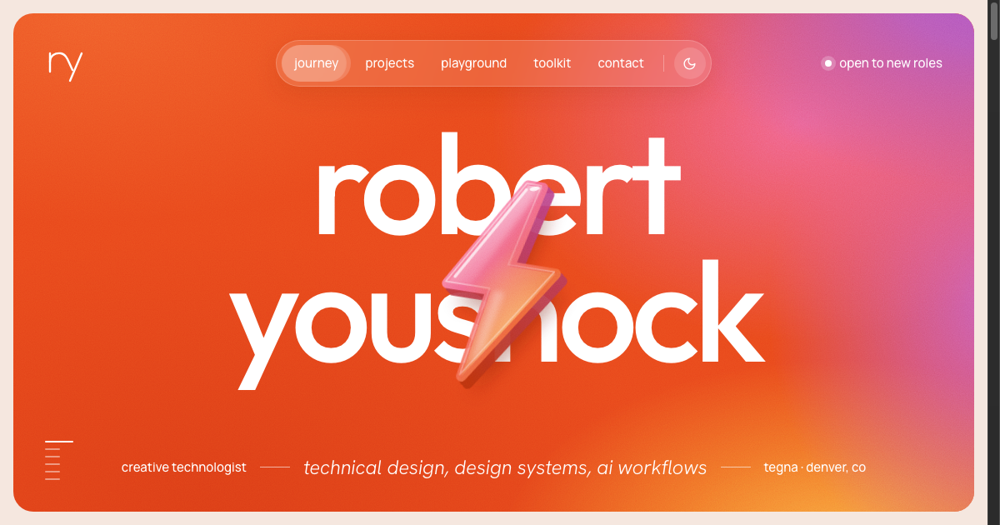
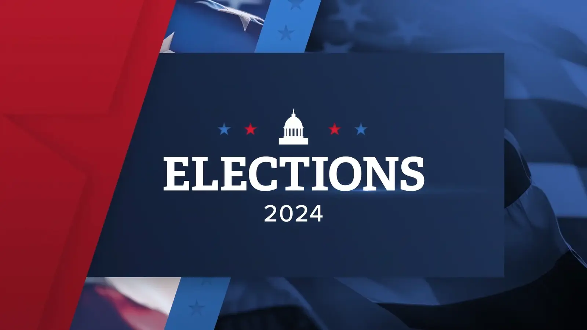
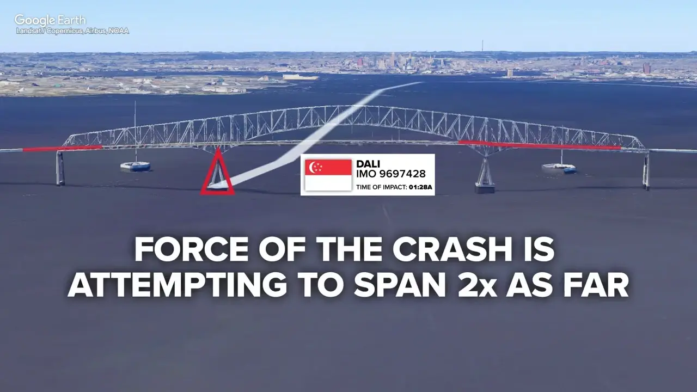
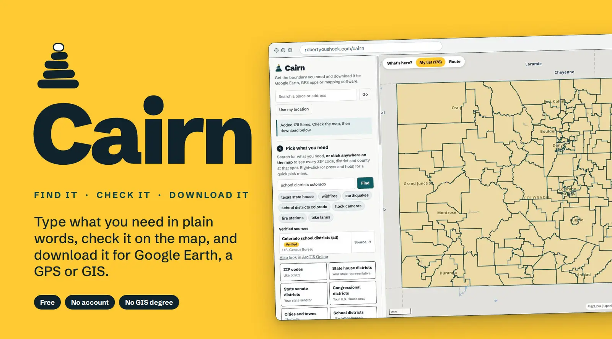
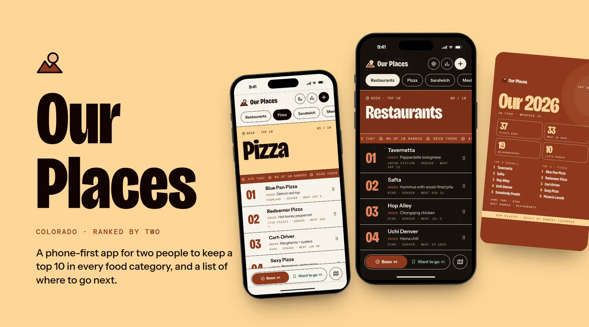

<p align="center">
  
</p>

# robertyoushock.com

**Creative Technologist: Technical design · Design systems · Generative AI workflows.**

The personal portfolio and design system of Robert Youshock, Emerging Technologies Designer at TEGNA (Denver, CO). Rooted in broadcast motion design, computational data visualization, and maps, turning live newsroom deadlines and production bottlenecks into shipped automation tools, vendor beta pilots, and high-performance web applications.

`Vanilla HTML · CSS · JS` · `Zero runtime dependencies` · `Zero framework bundle` · `WCAG AA compliant` · `GitHub Pages + Edge CDN` · `Light & Dark theme with circular bloom`

**[Explore the live site →](https://www.robertyoushock.com/)** · **[Read notes for AI agents →](https://www.robertyoushock.com/agents/)** · **[Design System Spec →](DESIGN.md)**

---

## The Broadcast Control Room

<p align="center">
  
</p>

A portfolio built around the metaphor of a live television control room: deep cathode ink surfaces, warm sunset test-pattern gradients, and precision tactile interaction.

- **Tactile timeline scrubbing.** Moving the cursor horizontally across any desktop project row directly scrubs through that broadcast animation's stills in real time, accompanied by a glowing 2px amber/orange progress bar (`.pv-bar`) and live SMPTE timecode HUD with scrub affordance (`.pv-hud`). Active scrubbing pauses auto-play; resting for 1.2s resumes smooth cycling from the playhead.
- **Touch-aware kinetic reels.** Mobile visitors receive scroll-driven frame cycling via `IntersectionObserver`, bringing television motion to touch viewports without requiring mouse hover.
- **Broadcast graphics at scale.** As a Motion Designer at TEGNA (2022 to 2025), Robert served as shift lead and final quality check for daily graphics deployed across 64 television stations, and led template design and animation for the nationwide 2024 Election package.
- **Editorial narrative case studies.** Every project breaks down into a clear **Production Brief** (the constraints, timeline, and delivery requirements) and **On-Air Delivery** (the technical template architecture, Chyron Prime integration, and station toolkits).

---

## Internal Enterprise Pipelines

<p align="center">
  
</p>

Behind the broadcast graphics sits years of workflow automation, tooling, and pipeline engineering:

- **ExtendScript & JSX automation.** Custom After Effects and Photoshop scripts built to turn hours of repetitive breaking news mapping into single-click automated renders.
- **Gen-AI virtual-set pipeline.** An internal pilot turning generative AI image generation into multi-angle, 3D-perspective broadcast newsroom backdrops under strict visual continuity constraints.
- **15-station beta pilot.** Run directly with a software vendor's product engineering team to stress-test, benchmark, and deploy automated newsroom mapping tools across 15 pilot markets under real deadline pressure.
- **Enterprise confidentiality.** Internal TEGNA automation systems are documented with explicit capability badges (`internal · TEGNA`) and transparent scope notes, keeping proprietary architecture protected while demonstrating system depth.

---

## Independent Web Apps & Tools

<p align="center">
  
</p>

When not building broadcast graphics and automation pipelines, Robert designs and ships zero-cost, serverless web tools:

- **[Cairn](https://www.robertyoushock.com/cairn/)** · `Vanilla JS` · `MapLibre` · `Census & ArcGIS APIs` · `$0/month`  
  A free web tool for finding US map boundaries in plain English ("texas state house", "flood zones"), verifying them on an interactive map, and exporting clean KML, KMZ, GPX, or GeoJSON files for Google Earth, GPS watches, and GIS software.  
  *[Code on GitHub →](https://github.com/robertyoushock/Cairn)*

- **[Our Places](https://eats.robertyoushock.com/?demo)** · `Cloudflare Pages + D1` · `Vanilla JS` · `SQLite` · `$0/month`  
  A fast, collaborative place ranking and spatial shortlist web app built for real-world trip planning with zero database subscription costs.  
  *[Code on GitHub →](https://github.com/robertyoushock/our-places-showcase)*

---

## The Design System

<p align="center">
  
</p>

The entire site is built on an authored, machine-readable design system documented in [`DESIGN.md`](DESIGN.md) and [`.impeccable/design.json`](.impeccable/design.json):

- **The Warm Spectrum.** The brand color palette flows through a four-stop broadcast sunset sequence:
  - `Warm Amber` (`#F6A23C`) → `Sunset Orange` (`#E8481C`) → `Kinetic Pink` (`#F0668C`) → `Spectrum Violet` (`#B05BC8`).
- **Circular bloom view transitions.** Switching between dark broadcast ink (`#1F1D1D`) and warm daylight paper (`#FAF7F4`) triggers a circular clipping mask (`clip-path: circle(...)`) radiating smoothly outward from the theme toggle button.
- **Architectural typography.** Monumental `Bricolage Grotesque` display titles with tight line-height (`0.92`) and negative tracking (`-0.04em`) paired with `Manrope` for effortless reading comfort.
- **Rigorous accessibility.** Built to WCAG AA standards with ≥ 4.5:1 text contrast in both light and dark modes, clear focus rings (`outline: 2px solid var(--amber)`), skip links, and full `prefers-reduced-motion` compliance.

---

## Built for Both Humans and AI Agents

- **`/agents/` page:** A dedicated, human-readable summary ([`robertyoushock.com/agents/`](https://www.robertyoushock.com/agents/)) written specifically for AI assistants (ChatGPT, Claude, Perplexity) clarifying verified skills, resume numbers, and distinguishing internal vs. public projects.
- **`/llms.txt`:** Plain-text markdown manifest for language model crawlers, indexed directly in [`robots.txt`](robots.txt).
- **Structured Schema.org Data:** Comprehensive JSON-LD metadata for `Person`, `CreativeWork`, and `SoftwareApplication` embedded on every page.
- **Rich OpenGraph & Twitter Cards:** Full 1600×900 and 1200×630 metadata with descriptive alt text for instant link unfurling across Slack, Discord, Twitter/X, and LinkedIn.

---

## Local Development & Build

The codebase is entirely static with zero client-side dependencies. Subpages and metadata are built via a clean, dependency-free Python script.

```bash
# Clone the repository
git clone https://github.com/robertyoushock/robertyoushock.github.io.git
cd robertyoushock.github.io

# Rebuild all 8 case studies, agents page, 404, sitemap, and _headers
python3 _src/build.py

# Preview locally with any static web server
python3 -m http.server 8000
# open http://localhost:8000
```

---

## Contact & Links

- **Website:** [robertyoushock.com](https://www.robertyoushock.com/)
- **Email:** [robertyoushock@gmail.com](mailto:robertyoushock@gmail.com)
- **LinkedIn:** [linkedin.com/in/robert-youshock-1ba979108](https://www.linkedin.com/in/robert-youshock-1ba979108/)
- **GitHub:** [github.com/robertyoushock](https://github.com/robertyoushock)
- **Resume:** [View Official Resume](https://drive.google.com/file/d/1pe5GCmHrd4w9osHMgBbQyYB7ftix2-LO/view)
